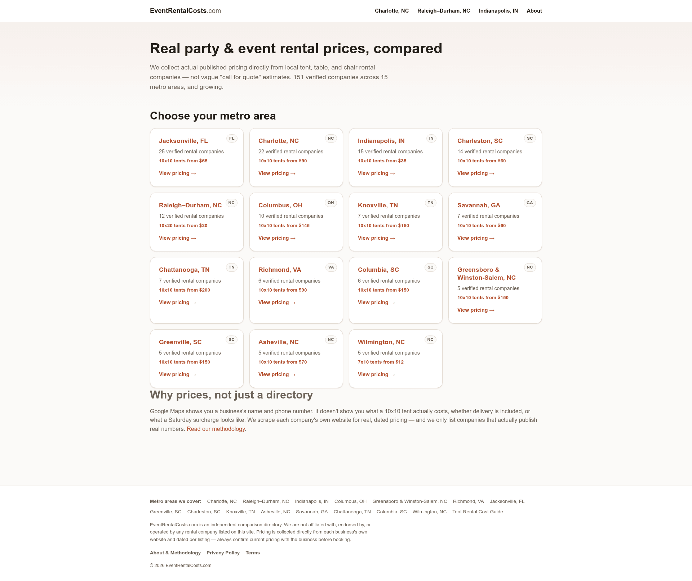

# DESIGN.md: EventRentalCosts.com (source of truth for the tools hub's visual match)

## Source
- URL: https://eventrentalcosts.com/
- Local source: `E:\Claude\Workspaces\Niche Directory\website` (Astro project — this is the ground-truth source, not the live-page guess)
- Capture date: 2026-08-05
- Evidence: read `src/styles/global.css`, `src/layouts/BaseLayout.astro`, `src/components/Header.astro`, `src/components/Footer.astro`, `src/components/ThreeStateBadge.astro`, `src/pages/index.astro` directly (authoritative — actual CSS custom properties, not inferred); cross-checked with a live Firecrawl `branding` + full-page `screenshot` scrape of the deployed site.

**Correction note:** Firecrawl's automated `branding` extraction guessed the primary font as literally "Roboto" and border-radius as `0px`. Both are wrong — the source CSS shows a system-native font stack (`-apple-system, BlinkMacSystemFont, "Segoe UI", Roboto, Helvetica, Arial, sans-serif`, where Roboto is just one fallback, not the actual rendered font on most devices) and three real border-radius tokens (6/10/16px) used throughout. This file uses the code as ground truth; the scrape only confirmed the color palette and overall layout impression.

## Reference Screenshot

Warm, editorial, trust-building directory aesthetic — not a typical SaaS/dark-mode-first look. Terracotta accent against a warm off-white background reads as human and considered rather than templated.

## Design Summary
A comparison-directory site built to feel trustworthy and human, not corporate. Warm off-white background (not pure white, not gray), a terracotta/rust primary color used sparingly for links, CTAs, and hover states, a deep muted green as a secondary accent (success states, subtle contrast). System-native font stack — no webfont loading cost, matches the project's zero-infrastructure-cost ethos. Generous but restrained border radius (16px on cards, 10px on buttons) gives a soft, approachable feel without looking like a template. Shadows are warm-toned (`rgba(31,27,22,...)`, not pure black) and very subtle — barely-there elevation, not drop-shadow-heavy.

## Design Tokens

### Colors
| Role | Value | Usage |
|---|---|---|
| `--color-bg` | `#fbfaf8` | Page background — warm off-white, never pure `#fff` |
| `--color-surface` | `#ffffff` | Cards, header, footer — pure white surfaces on top of the warm bg |
| `--color-border` | `#e4ded4` | All borders — warm tan-gray, never pure gray |
| `--color-text` | `#1f1b16` | Body/heading text — warm near-black |
| `--color-text-muted` | `#6b6257` | Secondary text, labels, nav-muted state |
| `--color-primary` | `#b5502f` | Terracotta/rust — links, primary buttons, active/hover states, CTAs |
| `--color-primary-dark` | `#8f3d22` | Primary button hover state |
| `--color-accent` | `#2f6b5e` | Deep muted teal-green — secondary accent, sparingly used |
| `--color-success` | `#2f6b3a` | Positive badge state (e.g. "Yes, delivery included") |
| `--color-unknown` | `#8a8175` | Neutral/unpublished badge state |

All confirmed directly from source CSS (`src/styles/global.css`), not inferred.

### Typography
- **Font stack:** `-apple-system, BlinkMacSystemFont, "Segoe UI", Roboto, Helvetica, Arial, sans-serif` — system-native, zero webfont cost. Use this exact stack for the tools hub, not a Google Font — matches the sibling site and keeps both sites' load performance/cost profile consistent.
- **h1:** `clamp(1.75rem, 1.4rem + 1.5vw, 2.5rem)`, weight 700, line-height 1.2
- **h2:** `clamp(1.4rem, 1.2rem + 1vw, 1.9rem)`, weight 700
- **h3:** `1.15rem`, weight 700
- **body:** default size, line-height `1.55`
- **small/label text:** `0.8rem`–`0.92rem`, often `text-transform: uppercase; letter-spacing: 0.03em` for table headers and tags

### Spacing and Layout
- Spacing scale (rem): `1: 0.25`, `2: 0.5`, `3: 0.75`, `4: 1`, `6: 1.5`, `8: 2`, `12: 3`, `16: 4`
- Border radius: `sm: 6px`, `md: 10px` (buttons), `lg: 16px` (cards)
- Max content width: `1120px`, centered, `padding: 0 1rem` on the container
- Shadows (warm-toned, very subtle):
  - `sm`: `0 1px 2px rgba(31,27,22,.06), 0 1px 3px rgba(31,27,22,.08)`
  - `md`: `0 4px 10px rgba(31,27,22,.08)`

## Components

**Buttons**
- Primary: solid `--color-primary` bg, white text, `radius-md` (10px), weight 600, padding `0.75rem 1.5rem`, no border. Hover → `--color-primary-dark`.
- Secondary: transparent bg, `--color-primary` text and 1.5px border. Hover → `rgba(181,80,47,.08)` bg tint.

**Cards** (`.card`)
- `--color-surface` bg, 1px `--color-border`, `radius-lg` (16px), `shadow-sm`. Homepage metro cards add `padding: 1.5rem`, a small absolute-positioned pill "state tag" (top-right, `radius: 999px`, bordered), and a hover state that just changes border color to primary — no lift/shadow-grow, keeps it calm.

**Badges** (three-state pattern, from `ThreeStateBadge.astro`)
- Pill shape (`radius: 999px`), small (`0.8rem`, weight 600), tinted background at ~12% opacity of the state color + solid text in that color.
- Three states, and this distinction matters: **yes** (green tint), **no** (muted-gray tint), **unknown/not-published** (separate neutral tint — never coerce "we don't know" into a "no," that was a real bug on the source site once real businesses were falsely described as not offering something).

**Tables**
- Full-width, `border-collapse: collapse`, `font-size: 0.92rem`. Header row: muted-color text, weight 600, `0.8rem`, uppercase, letter-spacing. Row borders only on the bottom (`1px solid --color-border`), no vertical rules.

**Nav header**
- Simple flex row, wordmark logo as plain bold text (not an image) with a lighter-weight muted suffix (e.g. "EventRentalCosts" bold + ".com" muted) — a workable pattern for the tools hub's own wordmark. Nav links plain text, weight 600, hover → primary color, no underline until hover.

**Footer**
- Border-top, surface background, generous top margin from content (`--space-16`), stacked sections (link nav, a disclosure/trust paragraph in muted small text, copyright line). The disclosure-paragraph pattern (explaining data sourcing / independence) is a real trust-building device worth carrying over conceptually — the tools hub's equivalent would be a short line clarifying tools are free/independent, not making unverifiable claims.

**Ad slot**
- Dashed border placeholder box, muted text, centered — reserves ad space visually without pretending it's content.

## Page Patterns
- Hero: generous top/bottom padding (`--space-12` / `--space-8`), a very subtle radial/linear tint of the primary color fading to transparent as background (`linear-gradient(180deg, rgba(181,80,47,.06), transparent)`) — not a solid color block, not an image.
- Content sections wrapped in `.container` (1120px max), stacked vertically with generous spacing.
- Card grids: CSS grid, `repeat(auto-fill, minmax(240px, 1fr))` — responsive without media queries for the grid itself.
- Mobile: nav simplifies by hiding secondary links below 640px rather than collapsing into a hamburger — keep this "reduce, don't hide behind a menu" instinct for the tools hub's nav too, since it's a similarly small link set.

## Content Style
- Direct, concrete, numbers-first headlines ("Real party & event rental prices, compared" — not "Find the perfect rental for your event!"). States what the site actually does, avoids marketing fluff.
- CTA copy: plain and specific ("View pricing →"), not generic ("Learn more", "Get started").
- A visible, specific trust/methodology statement near the top or in the footer — this site earns trust by being explicit about how data was collected, not just claiming quality.

## Agent Build Instructions
For the tools hub (`E:\Claude\Workspaces\Tool 1`), to visually match this sibling site:

1. **Replace the current plain-Tailwind default styling** with this exact color palette as Tailwind v4 theme tokens (via `@theme` in `global.css`, since Tailwind 4 is CSS-first) — map `--color-bg`, `--color-surface`, `--color-border`, `--color-text`, `--color-text-muted`, `--color-primary`, `--color-primary-dark`, `--color-accent`, `--color-success`, `--color-unknown` directly.
2. **Drop the current dark-mode-by-default plain Tailwind slate palette** built in session 2 — this sibling site is light-only, warm-toned, no dark mode. Decide explicitly whether the tools hub keeps dark mode (reasonable for a *tool* site where users may want it) or drops it to match — this is a real design decision, not an automatic "must match everything" call, since the two sites serve different interaction patterns (directory browsing vs. active tool use). Recommend: keep dark mode as an option on the tools hub (genuinely useful for a calculator someone might use at night while planning), but make the *light* mode match this palette exactly, so brand continuity holds for the majority of visits and any cross-linked traffic.
3. Use the same font stack (system-native, not a Google Font) — already matches what session 2 built by accident (Tailwind's default sans stack is close but not identical; make it exact).
4. Reuse the `.card`/`.button`/`.badge` visual language for tool UI chrome (e.g. the Budget Planner's category rows could sit inside a `.card`-styled container; a future "verified real data" badge on the Tent Size Calculator's guide content could reuse the badge pattern).
5. Match radius values exactly (6/10/16px) — replace Tailwind's default `rounded-md`/`rounded-lg` scale with these via `@theme` overrides so utility classes stay ergonomic but resolve to the sibling site's actual values.
6. Reuse the header wordmark pattern (bold brand name + muted suffix) for "Event Tools" — e.g. "Event **Tools**" or similar bold/muted split, not a generic logo mark.
7. Add a short trust/independence line in the footer, in the same spirit as the disclosure paragraph — something like clarifying these are free, independently-run tools, no account/data collection (this also reinforces the Privacy Policy page already written).

## Rerun Inputs
workflow: firecrawl-website-design-clone
source_url: https://eventrentalcosts.com/
target_stack: Astro 7 + Tailwind 4
output: DESIGN.md
